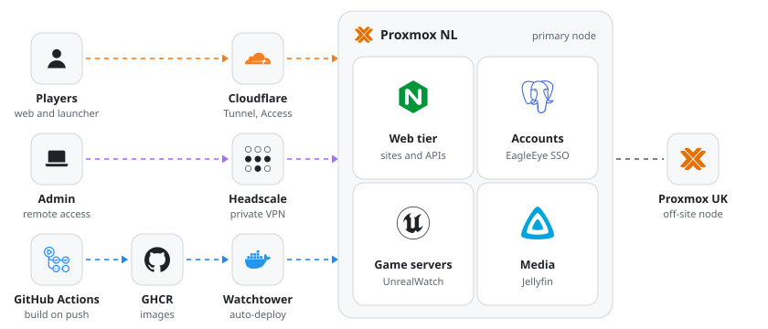

  

  
  
  

### About me

I'm a student at Windesheim who likes building complete systems: the game, the launcher, the backend and the servers it all runs on. Everything I make is self-hosted on my own hardware and deploys itself on every push.

### Projects

**UnrealWatch**: my biggest project. A competitive hero shooter in Unreal Engine 5.8, with dedicated servers, a Tauri launcher, a FastAPI backend for accounts, matchmaking and chat, a Next.js website and a Discord bot.

**[EagleEye Games](https://games.eagleeye.ro)**: a Battle.net style launcher and games hub, with its own account service for single sign-on, 2FA and one friends list across games.

**EagleEye**: my personal AI hub. A local model on an RTX 5090 handles everyday chat and hands real work to a team of Claude agents, with nothing happening without my approval.

**[Rooster](https://rooster.amdschuurman.nl)** and **[amdschuurman.nl](https://amdschuurman.nl)**: smaller ones. A planner that combines my school timetable with live NS trains, and my Astro portfolio.

### Homelab

<picture>
  <source media="(prefers-color-scheme: dark)" srcset="./assets/homelab-dark.svg"/>
  
</picture>

### Stack

  <picture>
    <source media="(prefers-color-scheme: dark)" srcset="https://skillicons.dev/icons?i=cpp%2Cunreal%2Cpy%2Cfastapi%2Cts%2Creact%2Cnextjs%2Ctauri%2Crust%2Cpostgres%2Credis%2Cdocker%2Ccloudflare%2Clinux&perline=14&theme=dark"/>
    
  </picture>

<picture>
  <source media="(prefers-color-scheme: dark)" srcset="./assets/stats-dark.svg"/>
  
</picture>

  <picture>
    <source media="(prefers-color-scheme: dark)" srcset="https://raw.githubusercontent.com/amdschuurman/amdschuurman/output/snake-dark.svg"/>
    
  </picture>

